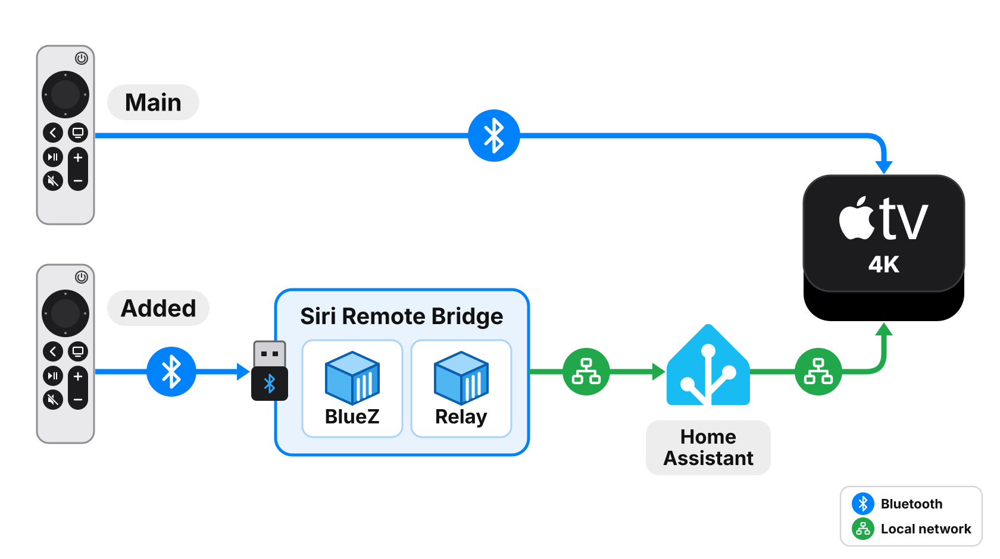
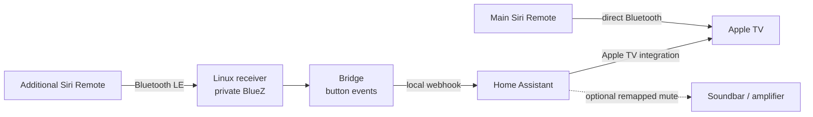

# Siri Remote Bridge

**Use two Siri Remotes with one Apple TV.** Keep your main remote paired to the
Apple TV as usual. Pair a second Siri Remote with a nearby Linux receiver instead;
this bridge sends its buttons through Home Assistant to the **same Apple TV**.
Both remotes can control it at the same time. This also helps when the Apple TV
is hidden or too far away for a reliable direct Bluetooth connection.



*Blue shows Bluetooth; green shows the local network (Wi-Fi or Ethernet). The
Siri Remote Bridge box represents software: its BlueZ and relay containers run
on a Linux receiver with a dedicated Bluetooth adapter. Home Assistant forwards
the added remote's commands to the same Apple TV. The receiver can be a physical
host or a VM guest.*

The added remote handles most everyday buttons: navigation, Select and held
Select, Back, Home, playback, volume, and Power. Siri voice and touch swipes are
not available through the bridge; Mute can be mapped to another device in Home
Assistant. See [button behavior and limitations](#what-works).

[Apple TV 4K pairs with only one Apple TV remote directly at a time](https://support.apple.com/en-nz/guide/tv/atvbc9953e63/tvos).
The bridge lets the second remote work without replacing the main pairing.
**One added remote is physically tested.** Each bridge instance handles one
bonded remote. More added remotes would need separate, isolated receiver/bridge
deployments and Home Assistant webhooks; that arrangement has not been tested.

## How the second remote connects



The receiver can be a Linux PC, mini-PC, or VM with a dedicated Bluetooth adapter. Home Assistant can run on another machine. The bridge needs no public listener or cloud account.

## Is my setup compatible?

### Siri Remote

The bridge targets the **silver USB-C Siri Remote with a circular clickpad**. [Apple's identification guide](https://support.apple.com/en-ie/103233) shows the older models; [Apple's current Siri Remote page](https://www.apple.com/shop/product/mlfc4am/a/siri-remote) identifies the newer 4th generation.

| Remote | Bridge compatibility |
| --- | --- |
| **4th generation, USB-C** | The owner's reported model has working buttons on this bridge. Its Bluetooth device identifies as Apple vendor `004C`, product `0316`; its retail SKU has not been independently checked. Other units or firmware revisions need testing. |
| **3rd generation, USB-C** | Expected to work: the [pinned decoder](https://github.com/azais-corentin/siri-remote) was written for this generation. It has not been separately tested with this bridge. |
| **2nd generation, Lightning; 1st generation, black glass; older IR remotes** | Unsupported by the pinned input decoder. Other brands are unsupported too. |

A remote's own compatibility with an Apple TV does not guarantee compatibility with this Bluetooth decoder.

### Apple TV and Home Assistant

The installation tested here uses an **Apple TV 4K (4th generation)** with the USB-C remote paired to the Linux receiver. Apple lists both [3rd-generation](https://www.apple.com/shop/product/mw5g3am/a/siri-remote) and [4th-generation](https://www.apple.com/shop/product/mlfc4am/a/siri-remote) Siri Remotes as compatible with Apple TV 4K (1st generation) and later, plus Apple TV HD. The [Home Assistant Apple TV integration](https://www.home-assistant.io/integrations/apple_tv/) supports Apple TV devices of any generation and provides the `remote` and `media_player` entities this bridge uses. Individual commands can vary by Apple TV, tvOS version, and app; Apple's direct-pairing compatibility is not a bridge test.

| Requirement | Verified configuration and limit |
| --- | --- |
| Linux Bluetooth receiver | Debian 13, Linux 6.12, and one dedicated Intel BLE USB adapter tested. The BlueZ image rebuilds Debian 5.82 with a device-name security fix. No minimum kernel or host BlueZ release has been qualified. |
| Containers | Docker Engine with **Docker Compose v2** required. No minimum Engine or Compose point release has been established. Docker Desktop on macOS is not a supported Bluetooth receiver. |
| Home Assistant | Apple TV integration, webhook automations, and `remote.send_command` with `hold_secs`. **2026.8.1** tested; an earlier minimum has not been established. |
| Network and time | Receiver can reach Home Assistant on a private LAN; Home Assistant can reach Apple TV. Choose verified HTTPS where available. HTTP requires an explicit trusted-LAN opt-in because it exposes the scoped webhook secret to observers on that route. Synchronize the two hosts' clocks so stale button events are rejected correctly. |
| Other hardware | Other BlueZ-compatible adapters and ARM64 builds may work, but need qualification on that hardware. Use exactly one adapter for this bridge. |

Proxmox is optional. If using a VM, pass the Bluetooth adapter through persistently and install its firmware inside the guest. Do not share the adapter with another Bluetooth stack. See [hardware compatibility](docs/hardware.md) for the tested setup and limits.

## What works

| Remote input | Default action |
| --- | --- |
| Arrows | Navigate; held directions repeat for a bounded time. |
| Select tap / hold | Select on release / open the native held-Select context menu. |
| Back tap / hold | Go back one level / return to the Home Screen. |
| TV/Home tap / hold | Go Home / send a native held-Home command. |
| Play/Pause | Toggle playback. |
| Volume Up/Down | Send Apple TV network volume commands when the audio path supports them. |
| Mute | **Not native Apple TV mute through this bridge.** Remap the button in Home Assistant to mute a compatible soundbar, amplifier, speaker, or other external device. The included example uses a soundbar entity. |
| Power tap / hold | Open the power-focused menu when awake, or wake when asleep / send one explicit sleep command. A tap never confirms shutdown. |

**Limitations:** The Siri button and microphone do not work through this bridge. Touch swipes and double-clicks are also not implemented. It is not a full replacement for Apple's remote stack. TV power depends on the existing HDMI-CEC setup, and Apple TV network volume is not available for every audio path. See the [validation matrix](docs/validation.md) for physical test coverage.

## Set up

This repository is a Docker Compose project: [compose.yaml](compose.yaml)
defines the BlueZ and relay containers together, and [.env.example](.env.example)
shows the optional state-directory setting. Clone the whole repository because
the images are built from its Dockerfile and source. Docker Compose finds
`compose.yaml` automatically, so the commands below work without copying a
separate YAML file. The receiver may be a Linux host or a Linux VM with the
dedicated Bluetooth adapter attached.

If your Compose interface accepts a Git repository **and builds images from its
source**, use `https://github.com/RobinMJD/siri-remote-bridge.git` as the
repository URL and `compose.yaml` as the Compose path. Choose an absolute
`STATE_DIRECTORY` on the Linux receiver from the start; replace `private` with
that path in the commands below. Complete the one-time pairing and Home
Assistant steps in a local checkout. Then run `docker compose down` there
(without `-v`) before deploying the project through your interface. Set the
same `STATE_DIRECTORY` in the interface. Never run both projects against the
same Bluetooth adapter or bond directory.

### 1. Build and prepare private state

Clone a reviewed release or commit on the Linux receiver. These commands use the repository's local `private/` directory. For a system install, set `STATE_DIRECTORY` in `.env` to an absolute local path and create the same subdirectories there. Never put private state in a shared or publicly served directory.

```sh
git clone https://github.com/RobinMJD/siri-remote-bridge.git
cd siri-remote-bridge
cp .env.example .env
# For a system install, edit STATE_DIRECTORY in .env and use that path below.
docker compose config -q
docker compose build bluez relay
sudo install -d -m 0700 private private/bluetooth
sudo install -d -m 0755 private/bus private/secrets
docker compose up -d bluez
```

### 2. Pair the spare remote once

Pairing with the receiver moves this remote away from its previous Apple TV pairing. Put only the intended remote near the adapter (about 50 cm), hold **Back/Menu + Volume Up** for about five seconds, then run:

```sh
docker compose run --rm --no-deps --user 0:0 \
  --entrypoint /usr/local/bin/siri-remote relay pair
```

Confirm the bonded **identity address**, rather than a rotating advertisement address. Stop if a different remote was selected. Routine startup never pairs a new remote or removes a bond. See [pairing recovery](docs/operations.md#pairing-repair) if pairing fails.

### 3. Create the scoped Home Assistant webhook

Substitute your Home Assistant hostname, port, and bonded remote identity. Use a hostname with a certificate trusted by the receiver for HTTPS:

```sh
sudo python3 configure.py --host ha.example.com --port 443 --scheme https \
  --address AA:BB:CC:DD:EE:FF --state-dir private
```

If Home Assistant is only available over HTTP on a trusted private LAN, explicitly choose `--scheme http --trusted-lan-http --port 8123` instead. Anyone able to observe that traffic can obtain the scoped webhook secret. Use your configured `STATE_DIRECTORY` as `--state-dir` if you chose a different path. The helper generates a random webhook secret without printing it and refuses to overwrite existing configuration. Transfer `private/home-assistant-secret.yaml` securely into Home Assistant's `secrets.yaml`. The relay receives only this scoped webhook, never a general Home Assistant API token. See [configuration](docs/configuration.md) for the fields and transport options.

### 4. Install the Home Assistant automation

Copy [the example automation](examples/home-assistant.yaml) to `/config/siri_remote_bridge.yaml`. Replace its example Apple TV entity IDs and, if used, the external audio entity ID with your own. Match its device marker to the bridge configuration. Add this separate include to Home Assistant's `configuration.yaml`:

```yaml
automation siri_remote_bridge: !include siri_remote_bridge.yaml
```

Keep an existing `automation: !include automations.yaml` in place. Keep the webhook `local_only: true`; do not expose it to the internet. Check Home Assistant's configuration, then reload **Automations**. A restart is not required. The separate include avoids putting a `!secret` webhook inside the UI-managed automation list.

### 5. Start and test the buttons

```sh
docker compose up -d
docker compose ps
docker compose logs --tail 30 relay
docker compose exec relay cat /run/siri-remote/status.json
```

`connected` means the decoder subscribed to the remote. `waiting_remote` is normal while it sleeps or is out of range. Try navigation and Select on the actual TV: an HTTP 200 response only confirms webhook delivery, not that a Home Assistant condition passed or the TV acted.

## Running and recovery

Both containers use `unless-stopped`: they recover after crashes and host/guest restarts, while an intentional stop stays stopped. The bridge reconnects to its stored remote identity without replaying old presses. It will not silently pair a replacement remote. A stopped VM or powered-off host still needs its own startup configuration.

If buttons arrive but do nothing, inspect Home Assistant automation traces and clock synchronization before changing Bluetooth state. Events expire after one second; the automation allows up to 250 ms of sender-ahead clock skew. For health checks, backup/restore, updates, and rollback, use [operations and recovery](docs/operations.md). Do not run a second BlueZ instance against the same adapter or bond store.

## Project notes

- [Architecture and configuration](docs/configuration.md)
- [Security model](docs/security.md) and [security reporting](SECURITY.md)
- [Hardware compatibility](docs/hardware.md) and [validation scope](docs/validation.md)
- [Contributing](CONTRIBUTING.md), [changelog](CHANGELOG.md), and [upstream attribution](THIRD_PARTY.md)
- [GPL-3.0-or-later license](LICENSE)

This is an early release tested on one real installation. It is not intended for locks, alarms, or other safety-critical controls.
